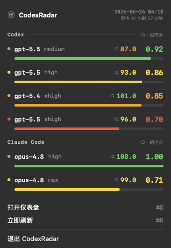

# CodexRadar

> 非官方 macOS 菜单栏小工具：跟随 codexradar.com 现行的同基准 Radar Bench（`radar-bench-v2-150`，满分 150）逐档成绩，弹窗里按分数、API 等价费用、耗时列出各模型思考档，并在数据可靠时给出本地计算的性价比推荐。

原生实现：`NSStatusItem` + `NSPopover`，弹窗用 `NSHostingController` 承载 SwiftUI。数据来自 [Codex 雷达](https://codexradar.com/) 的公开数据，仅做只读拉取。

> **现场核对（2026-10-24）**：codexradar.com 绑定仍是 `radar-bench-final64-20261004` / `radar-bench-v2-150`（150 分、64 任务、34 档），逐档 summary 为 `v6-150-details`，应用无需再迁移。
>
> **数据迁移说明（2026-10-18）**：网站已切换到 Radar Bench 同基准评分，旧的 `radar-insights` / `intelligence-efficiency-metrics` 接口目前返回 502，`current.json` 里的 `model_iq` 停留在 2026-09-13 的旧量纲。本应用已不再请求这三个旧地址，旧 IQ 与新分数**绝不混用**；网站的「站长推荐」场景（日常开发 / 难题攻坚）因此暂时没有数据，应用里的「推荐」一律是本地计算，不是站长推荐。

<p align="center">
  
</p>

## 功能

- **两种榜单模式**：默认「模型推荐」，按模型折叠，展开可看各思考档；「完整榜单」按分数降序列出全部档位。模式选择跨会话保存，刷新不会重置。
- **分数口径**：每行的「分」是 Radar Bench 的 score（满分取绑定里的 `score_max`，目前 150）。真实 0 分显示 `0.0`，尚无分数显示 `—`（两者不同）。覆盖不完整（`coverage < required_tasks` 或 `score_status` 不是 `complete`）的行带「暂定 43/64」/「待测」角标，分数用橙色提示还会变。旧的 100/90/80 阈值色不适用于新量纲：完整覆盖的分数一律中性色，不做好坏着色。
- **费用与耗时**：费用是官方标准 **API 等价费用**（不是订阅扣费，也不是现金账单）。均值只由已知样本算：`known_total / known_samples`，缺失样本不当 0；样本不全时数值后加 `*`，悬停/无障碍文本给出「已知 79/80 样本均值」。没有费用或耗时样本的行省略该字段，不显示 `$0.00`。耗时均值取原始 `elapsed_ms` 已知样本均值，有效性过滤与性价比的 1.1 倍耗时判断都按秒级精度计算（不经分钟取整）；展示时不足 1 分钟显示秒数（如 `45s`），不会出现有效的 `0m`。
- **本地推荐（非网站推荐）**：同一模型的全部绑定档位中，分数达最高档 95% 的候选里取 API 等价费用最低的一档。只在以下前提都满足时才给出，否则折叠行写明原因：① 绑定里该模型的所有档位都已成功读取；② 组内每档覆盖完整；③ 候选档位的费用样本齐全（有任一候选缺费用样本就不推荐，而不是猜）。行内标记为「本地推荐」，从不标成站长推荐。
- **菜单栏**：只有当**整批**档位都读取成功、覆盖完整、且没有读取失败时，才显示分数最高的档位（如 `● 6.1-sol·low`，中性蓝色，不套旧阈值色）；否则（局部批次）若已有覆盖完整的 GPT 档，显示灰色 `◐` 标记的临时型号与进度（如 `◐ 6.1-sol·low 30/34`，仅是「已读取完整档中最高」，不是全榜冠军，也不是站长推荐），悬停提示写明已读取/完整档数量、读取失败与数据过旧情况；还没有任何覆盖完整的 GPT 档时只显示进度 `○ 0/34`；没有任何数据时显示 `—`。
- **性价比标记与「只看前沿」**：仍在同一分组内比较——另一档「分数不低 + 费用更少 + 耗时不超过本档 1.1 倍」即压制本档（价格标橙，达 2 倍以上加 `×N` 角标），无人压制标绿。Radar Bench 行只有覆盖完整、费用与耗时样本都齐全的才参与判定，其余保持中性灰；判定始终基于全量数据，「只看前沿」开关与推荐项/菜单栏档位豁免规则不变，选择跨会话保存。
- **单行分区筛选**：`全部 | OpenAI | Claude Code | Grok | DeepSeek`，分区与榜单共用 `BoardSection.displayOrder`，没有内容的分区自动隐藏。目前绑定只包含 `gpt-*`，所以只有 OpenAI 分区；Claude / Grok / DeepSeek 不会用旧量纲数据凭空补出来，网站以后在绑定里加入对应模型时会自动出现（`claude-*` 沿用既有的并入 Claude Code 分区逻辑）。
- **读取状态可见**：头部分开显示「读取」（本地最近一次成功读取时间）与「评分」（接口 `detail_metrics.latest_graded_at` 给出的最近评分时间；接口没给就不显示，绝不拿当前时间顶替）。读取中显示进度 `读取中 12/34`；某些档位读取失败时头部写明数量，榜单里沿用旧结果的行带「缓存」角标，悬停可看成功读取时间和失败原因。
- **固定操作始终可达**：打开仪表盘 `⌘O` / 立即刷新 `⌘R` / 退出在滚动区之外。滚动区上限 = 屏幕可用高度 − 实测的头部、模式与筛选条、底部操作区高度，头部提示变长或榜单很长时底部操作也不会被挤出屏幕；口径说明单独成行、可换行，窄窗下不挤占模式切换。
- **轻量常驻**：无 Dock 图标；启动与每 30 分钟的后台轮询只读绑定并补读缺失/过期（≥ 3 小时）的档位，`⌘R` 手动刷新才重读全部档位，不会每次轮询都扫 34 个请求。
- **纯只读、不上传**：只请求两个公开地址（见「隐私」），不读取任何本机敏感数据。

## 环境要求

- macOS 13+
- Xcode 15+（Swift 5.9+）
- [XcodeGen](https://github.com/yonaskolb/XcodeGen)：`brew install xcodegen`

## 构建与运行

```bash
xcodegen generate                 # 由 project.yml 生成 CodexRadar.xcodeproj
open CodexRadar.xcodeproj          # 在 Xcode 里 ⌘R 运行
```

或纯命令行：

```bash
xcodegen generate
xcodebuild -project CodexRadar.xcodeproj -scheme CodexRadar -configuration Debug \
  -derivedDataPath build CODE_SIGNING_ALLOWED=NO build
open build/Build/Products/Debug/CodexRadar.app
```

运行后图标出现在菜单栏右侧（`LSUIElement = YES`，无 Dock 图标），点击弹出 popover。

Debug 构建会自动把弹窗各状态（正常 / 加载 / 错误）渲染到 `build/preview-renders/`；也可手动运行 `Tools/render_preview_states.sh`。

## 数据来源

唯一数据源是 codexradar.com 的 Radar Bench（`radar-bench-v2-150`）：

- **绑定**：`GET https://codexradar.com/data/radar-bench-binding.json`。必须 `enabled` 且 `production_read_verified`；`benchmark`、`catalog_version`、`score_version` 非空，`task_set_sha256` 为 64 位十六进制，`score_max > 0`，`total_tasks > 0`，`source_counts`（若有）之和等于 `total_tasks`；`model_efforts` 去重后保持绑定顺序（上限 128 项）。校验不过就不读任何成绩，沿用 24 小时内的缓存榜单并在头部提示。绑定里的 `transport_origin` / `endpoint_path`（`api.codexradar.com`）不使用，实际走已验证的站点路径。
- **逐档成绩**：`GET https://codexradar.com/api/radar-bench-score?model=…&effort=…&view=summary`，必须带 `X-Radar-Bench-Selection: user-selected-v1`（不带站点返回 428）。响应必须与绑定逐项一致：`schema`（`radar-bench-public-summary-*`）、`benchmark`、`catalog_version`、`task_set_sha256`、`score_version`、`score_max`、`required_tasks`、请求的 `model` / `effort`；`score` 为 `null` 或落在 `0…score_max`；`coverage` 在 `0…required_tasks`；`score_status == complete` 必须同时满足满覆盖且有分数；统计指标的 `known_samples + missing_samples` 必须等于 `sample_count`。任一不符整条拒绝，不降级采用。
- **解析与保留**：分数、覆盖（`coverage/required_tasks`）、已评分运行数（`graded_runs_count`）、费用与耗时的已知/缺失样本分别建模；完整原始响应（含尚未建模的新增字段）原样保留并随缓存存取。
- **请求策略**：评分请求去重后并发 ≤ 3（与站点自动队列一致）；站点繁忙（429 / 502 / 503 / 504、超时、连接中断）时单档最多尝试 3 次，等待遵循 `Retry-After`（秒数或 HTTP-date），没有时指数退避 2s、4s，单次等待上限 30 秒。任一请求遇到繁忙，其余 worker 的下一次请求也共享该冷却：每次真正发请求前（含已领取的档位和重试）都会重新检查取消、整批暂停与冷却，等待中冷却被其他 worker 延长时，醒来后继续遵守最新截止时间；整批被暂停后，已领取但尚未发送的档位与等待中的重试都不再发请求（已领取未发送计入「跳过」，已尝试过的计为失败，任务取消单独计数，进度统计闭合），已经在途的请求照常完成并合并。`Retry-After` 超过 30 秒、连续 3 个档位重试耗尽、或遇到 428，都会暂停整批（剩余档位不再请求），并进入冷却（有 `Retry-After` 就按它，否则 5 分钟），冷却期内拒绝后续刷新（手动刷新也一样）。
- **观测缓存**：每个档位最近一次**成功**的原始响应 + 成功读取时间存入 `UserDefaults`（`radarBenchCache.v1`）。载入时每条都按当前绑定重新校验，只接受 24 小时内的；超过 24 小时的观测不展示、不参与推荐。绑定的 `benchmark` / `catalog_version` / `task_set_sha256` / 计分版本 / 满分 / 任务数任一变化，已有观测与缓存整体作废，不跨基准混用；基准不变时只剔除已不在绑定里的档位。
- **时间**：「读取」= 本地时钟记录的成功读取时间；「评分」= 接口 `detail_metrics.latest_graded_at`（可带微秒，缺失则不显示）。两者独立存放、独立显示。
- **不再使用的旧地址**：`radar-insights`、`intelligence-efficiency-metrics`（当前 502）与 `current.json`（`model_iq` 停在 2026-09-13，旧量纲）。`/api/model-ratings` 是社区评分，不是这个基准，也不使用。旧解析函数与测试仍保留在 `RadarParser` 中（现已无调用方），以便网站日后恢复旧接口时参考，但不参与现行数据流。

### 部分失败的处理规则

- 每个档位独立合并：成功的读取覆盖该档位；失败的读取只记录原因，**已有的成功行与它的读取时间原样保留**，不会因为一次部分失败让榜单变短或变空。
- 本轮有任何档位读取失败时：菜单栏不声明榜首（显示灰色 `◐` 临时型号与进度，仅为已读取完整档中最高；无完整 GPT 档时显示 `○ n/N`），头部写明失败数量，沿用旧结果的行带「缓存」角标；行级「缓存」角标也会在成功读取超过 3 小时后出现。
- 绑定读取失败（含 502）：不读成绩，24 小时内的缓存榜单继续显示；没有缓存则头部显示错误。
- 没有任何有效观测时，榜单为空并显示错误，不会拿占位数据或 `Date()` 充数。

## 已知限制

- 站长场景推荐（日常开发 / 难题攻坚）依赖旧 `radar-insights`，目前没有数据，相关视图自动隐藏。
- 费用是 API 等价估算，不是订阅扣费；存在缺失样本的档位只有「已知样本均值」，且不参与性价比判定与本地推荐的候选比较。
- 菜单栏榜首要求整批 34 档全部读取成功且覆盖完整；有档位仍是「暂定」或读取失败时只显示 `◐` 临时型号（不是冠军，提示里有说明），这是有意的保守选择；菜单栏当前显示的型号（榜首或临时型号）在完整榜单与模型推荐里始终可达，不会被「只看前沿」隐藏。
- 读取到缓存的行最长可沿用 24 小时，沿用期间跨档位比较可能混有不同时刻的读取。
- 弹窗的实际布局/交互需要在真机上手动验证；本仓库的自动化测试覆盖解析、取数、合并、缓存与推荐逻辑，不包含对弹窗的真实点击验证。

## 隐私

只请求 `https://codexradar.com/data/radar-bench-binding.json` 与 `https://codexradar.com/api/radar-bench-score`（带 `model` / `effort` / `view=summary` 查询参数）两个公开地址，只读拉取、不提交任何数据，请求不携带 cookie。缓存只保存在本机 `UserDefaults`。系统时区仅用于本地格式化更新时间，不上传时区、定位或其他设备信息；不读取通讯录、日历、定位、照片或麦克风等敏感数据。

## 工程结构

```
Sources/
├── App/        入口 + AppDelegate（状态栏 / 弹窗 / 轮询 / ⌘O·⌘R 快捷键）
├── Model/      领域模型（Radar Bench 绑定 / 观测 / 推荐）+ 解析校验（RadarBenchParser）+ JSON 解码（JSONValue 保留未知字段；旧 CurrentResponse 等保留）
├── Service/    RadarService（绑定 + 逐档成绩，并发 / 重试 / 冷却）+ RadarBenchStore（24h 观测缓存）
├── ViewModel/  RadarViewModel（逐档合并 / 刷新触发 / 加载进度 / 相对时间 / 「只看前沿」与榜单模式偏好）
├── Views/      DesignTokens + 场景推荐区 + 分区筛选 + 榜单视图 + 头部 / 菜单栏 / 底部
└── Support/    VisualEffectView（深色毛玻璃）
Tests/
└── CodexRadarTests/  RadarParser / RadarService / RadarViewModel / StatusItemTitle 单元测试
```

## Git 仓库信息

- GitHub 仓库：[didogakki/CodexRadar-Menubar](https://github.com/didogakki/CodexRadar-Menubar)
- 默认分支：`main`；本仓库使用 MIT 许可证（详见下方）。

获取源码及查看提交记录：

```bash
git clone https://github.com/didogakki/CodexRadar-Menubar.git
cd CodexRadar-Menubar
git log --oneline -5
```

代码贡献请基于最新 `main` 创建分支并提交 Pull Request；提交信息建议使用简洁中文，勿提交密钥或本地构建产物。

## 免责声明

本项目为非官方客户端，不隶属于、也不代表 Codex 雷达网站、OpenAI、Anthropic 或其他第三方。网站名称、数据、商标和内容归各自权利人所有。

## 许可证

[MIT License](LICENSE)。MIT 只适用于本仓库代码，不授予任何第三方网站数据、品牌、商标、图标或内容的再授权。
